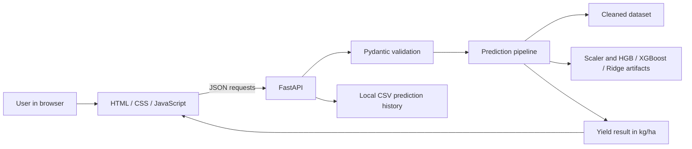

# CropPredict – Crop Yield Prediction System

[](https://www.python.org/)
[](https://fastapi.tiangolo.com/)
[](https://scikit-learn.org/)
[](https://xgboost.readthedocs.io/)
[](LICENSE)

## Project Title and Introduction

CropPredict is a browser-based crop-yield estimation tool backed by a FastAPI service and a pre-trained stacking ensemble. It accepts a crop, country, and year, returns an estimated yield in kilograms per hectare, and supports scenario comparison, local prediction history, and a global feature-importance view.

The deployed prediction path uses a `HistGradientBoostingRegressor` and an XGBoost model as base estimators, with Ridge Regression as the meta-model. Predictions and future forecasts are produced from the model artifacts and cleaned dataset included in this repository; the application does not train models at startup.

## Project Overview

| Item | Implementation |
|---|---|
| Project | CropPredict – Crop Yield Prediction System |
| Backend | FastAPI application served with Uvicorn |
| Frontend | Static HTML, CSS, and browser JavaScript |
| Prediction target | Crop yield in kg/ha |
| Supported crops | Maize, rice, and wheat |
| Supported countries | 15 countries encoded in the model |
| Historical coverage | 1990–2023 in the cleaned prediction dataset |
| Forecast input range | 1990–2100, validated by the API |
| Model strategy | HistGradientBoosting + XGBoost → Ridge meta-model |

## Problem Statement

Agricultural yields vary across crops, countries, and years. CropPredict brings historical yield, climate, and fertilizer-related indicators together in a single prediction workflow. It provides estimates for selected country/crop/year combinations and an iterative forecast beyond the latest year represented in the cleaned dataset.

The output is a model estimate for decision support. It is not a guaranteed harvest outcome, an agronomic recommendation, or a substitute for local expertise.

## Objectives

- Provide a simple interface for requesting crop yield estimates.
- Reuse a trained ensemble over a common, engineered feature set.
- Support historical-year estimates and iterative forecasts after 2023.
- Compare two prediction scenarios with their signed yield difference.
- Keep a local CSV record of successful requests and allow export.
- Expose the available global XGBoost gain-importance ranking without presenting it as a per-prediction explanation.

## Key Features

| Feature | Description |
|---|---|
| Yield prediction | Request an estimate for one supported crop, country, and year. |
| Historical and future modes | Use historical features through 2023; iteratively roll predictions forward for later years. |
| Scenario comparison | Compare two independent requests and receive both estimates plus their difference in kg/ha. |
| Prediction history | Save successful prediction results to a local `prediction_history.csv` file. |
| CSV export | Download the saved history using the `/history/export` route. |
| Feature ranking | View the leading global feature gains from the XGBoost component. This is not SHAP and does not explain an individual ensemble prediction. |
| Responsive interface | Use the single-page frontend served by the FastAPI application. |

## Technology Stack

| Layer | Technologies |
|---|---|
| API | Python, FastAPI, Pydantic, Uvicorn |
| Models | scikit-learn (`HistGradientBoostingRegressor`, `Ridge`), XGBoost |
| Data and serialization | pandas, NumPy, joblib |
| Frontend | HTML, CSS, vanilla JavaScript |
| Local history | CSV file managed by the FastAPI application |

There is no Node.js frontend build step. The current dependencies are listed in [`requirements.txt`](requirements.txt).

## Machine Learning Architecture

The serving code in `model_utils.py` loads the fitted estimators and scaler from `models/`. It builds a feature vector in the saved training order, scales it, obtains predictions from the HGB and XGBoost estimators, and passes those two predictions to the fitted Ridge meta-model.

```text
41 engineered input features
            │
            ▼
    StandardScaler
       ┌────┴────┐
       ▼         ▼
 HistGradient  XGBoost
 Boosting         │
       └────┬────┘
            ▼
     Ridge meta-model
            │
            ▼
      Yield estimate
          (kg/ha)
```

The API loads `hgb_model.pkl`, `xgb_model.json`, `ridge_meta.pkl`, and `scaler_hybrid.pkl`. Random Forest artifacts and other model experiments are present in the repository, but they are not part of this serving path.

## Dataset Description

The active cleaned dataset is [`data/cleaned/final_cleaned_dataset.csv`](data/cleaned/final_cleaned_dataset.csv). Inspection of that file shows **3,289 rows and 43 columns**, covering **1990–2023**, with one yield target, a year field, and 41 model input features. It represents 15 countries and three crops.

| File | Role |
|---|---|
| `FAOSTATdata.csv` | Agricultural production records used for yield data. |
| `FAOSTATnutritif.csv` | Fertilizer input records; source column labels include French names. |
| `climate.csv` | Country/year climate and related indicators; the pipeline notebook labels this source `WorldBk`. |
| `final_merged_dataset.csv` | Merged dataset retaining country and crop labels. |
| `FAO_climate_fert_yield_cleaned.csv` | Cleaned, feature-engineered dataset output from the notebook pipeline. |
| `data/cleaned/final_cleaned_dataset.csv` | Cleaned one-hot encoded dataset used by the prediction code. |

The feature set includes yield history and rolling statistics, fertilizer totals and intensity, temperature and rainfall measures and lags, population, forest area, renewable energy, CO₂, extreme-weather events, sea-level rise, normalized year terms, and one-hot crop/country indicators. The country and crop categories are encoded as columns rather than stored as plain text in the serving dataset.

## Data Preprocessing

The notebooks document the preparation process used to create the supplied cleaned dataset:

1. Normalize country names across production, fertilizer, and climate sources, including the French-language fertilizer country labels; normalize crop labels and year/value types.
2. Keep the supported country/crop coverage and join fertilizer and climate features to production records on country and year while retaining production rows.
3. Fill missing climate values using time-aware interpolation by country where available. Fill remaining fertilizer and feature gaps using the notebook's median-based fallback and remove records without a usable yield target.
4. Engineer previous-year yield lags, three-year rolling yield statistics, temperature/rainfall lag and anomaly features, fertilizer intensity, normalized year features, and categorical indicator columns.
5. Apply the notebook's per-crop, percentile-based yield outlier screening and prepare the final model feature matrix.
6. Scale the model inputs with the saved `StandardScaler` before inference.

The API consumes the already-prepared CSV; it does not rerun these raw-data cleaning steps at launch.

## Exploratory Data Analysis

The notebooks and saved image files contain model-development and diagnostic visualizations, including actual-versus-predicted values, residuals, error distributions, feature importances, learning curves, and metric comparisons. Relevant files include `model_comparison.png`, `feature_importance.png`, and the images under `outputs/`.

These are saved analysis artifacts from notebook experiments. They should not automatically be interpreted as a fresh evaluation of the currently served ensemble. No accuracy or R² claim is made here; use a reproducible evaluation run with a documented data split before presenting performance figures.

## Model Development

The repository includes notebooks for data preparation and multiple model experiments. The serving implementation is narrower:

1. The pre-trained HGB and XGBoost estimators each produce a yield prediction from the same scaled 41-feature vector.
2. The Ridge meta-model combines the two base predictions into the final estimate.
3. The final value is rounded to one decimal place and returned with a note identifying historical or forecast mode.

For a historical request through 2023, the code selects the latest matching country/crop row at or before the requested year. For a request after 2023, it seeds lag features from the latest available row and predicts year by year, rolling each prediction into the next year's lag features.

Model files are serialized artifacts and are version-sensitive. See [Installation and Setup](#installation-and-setup) and [Limitations](#limitations) for the compatibility caveat observed while verifying this repository.

## System Architecture



The FastAPI process loads model artifacts and the cleaned dataset at startup. The frontend is served from the repository root, and its JavaScript calls the API on the same origin.

## Application Workflow

1. The user selects a year, country, and crop in the browser.
2. FastAPI validates the request. Supported years are 1990–2100; crops and countries are constrained to the configured model categories.
3. The prediction utility finds a matching historical row or builds fallback features when a matching row is unavailable.
4. It constructs the 41 features in the model's expected order, scales them, and runs HGB, XGBoost, then Ridge.
5. For years after 2023, the pipeline repeats prediction one year at a time and rolls the predicted yield into subsequent lag features.
6. A successful prediction is returned and appended to `prediction_history.csv`. Comparison requests calculate both results and save both entries.
7. The interface renders the result, comparison, local history, or global XGBoost feature ranking requested by the user.

## API Endpoints

FastAPI's interactive schema is available at `/docs` while the service is running.

| Method | Route | Purpose |
|---|---|---|
| `GET` | `/` | Serve the CropPredict page. |
| `GET` | `/styles.css` | Serve the frontend stylesheet. |
| `POST` | `/predict` | Return one yield estimate and a historical/forecast note. |
| `POST` | `/compare` | Predict two scenarios and return their signed difference. |
| `GET` | `/history` | Return successful prediction history as JSON. |
| `GET` | `/history/export` | Download prediction history as CSV. |
| `POST` | `/explain` | Return the top global XGBoost component gain features. |

### Prediction request

```json
{
  "year": 2025,
  "country": "usa",
  "crop": "maize"
}
```

Example response shape:

```json
{
  "yield": 7398.8,
  "note": "Iterative forecast from 2023 to 2025"
}
```

The API returns HTTP `422` for invalid request values. Prediction failures are returned as HTTP `500` responses with a detail message.

### Comparison request

```json
{
  "first": { "year": 2023, "country": "usa", "crop": "maize" },
  "second": { "year": 2025, "country": "india", "crop": "rice" }
}
```

The response contains the request and prediction details for `first` and `second`, plus `difference_kg_ha` (first yield minus second yield).

### Feature ranking scope

`POST /explain` uses the same request shape as `/predict`. It returns a global gain-importance ranking from the XGBoost component. The response explicitly notes that the values are not SHAP values, do not attribute an individual ensemble prediction, and do not establish causation.

## Installation and Setup

Use Python 3.11 for the verified local setup. Run the commands from the repository root so the relative model and dataset paths resolve correctly.

### Windows PowerShell

```powershell
py -3.11 -m venv .venv
.\.venv\Scripts\Activate.ps1
python -m pip install --upgrade pip
python -m pip install -r requirements.txt
python -m pip install "scikit-learn==1.8.0" "numpy==2.2.6" "xgboost==2.1.4"
```

The final install line selects the compatibility versions used for the verification described below. The serialized scikit-learn estimators still emit an `InconsistentVersionWarning`; see [Limitations](#limitations). The dependency manifest itself does not pin these versions.

## How to Run the Application

From the repository root, with the virtual environment active:

```powershell
python -m uvicorn app:app --host 127.0.0.1 --port 8000
```

Open the application at [http://127.0.0.1:8000](http://127.0.0.1:8000). Open [http://127.0.0.1:8000/docs](http://127.0.0.1:8000/docs) for the interactive API documentation. Stop the local server with `Ctrl+C`.

### Verify a prediction from PowerShell

```powershell
$body = @{ year = 2025; country = "usa"; crop = "maize" } | ConvertTo-Json -Compress
Invoke-RestMethod -Uri "http://127.0.0.1:8000/predict" `
  -Method Post -ContentType "application/json" -Body $body
```

Successful requests are written to `prediction_history.csv` beside `app.py`. Keep this file local if you do not want to retain test or user-submitted predictions.

## Sample Prediction Results

The following is an illustrative **single runtime response** generated from the repository's current model artifacts for USA maize, forecast year 2025. It demonstrates response format and is not an accuracy metric or a claim about real-world performance.

| Year | Country | Crop | Returned estimate | Note |
|---:|---|---|---:|---|
| 2025 | USA | Maize | 7,398.8 kg/ha | Iterative forecast from 2023 to 2025 |

The value may change if the model artifacts, libraries, or input data change. Treat forecasts as estimates, not observed yields.

## Screenshots

To make this section portfolio-ready, capture the running application and add the images to a new `docs/images/` directory. Replace each placeholder below with the corresponding Markdown image link.

<!-- TODO: Replace this placeholder with a real application screenshot. Example:  -->

> **Prediction form:** Insert a screenshot showing the crop, country, and year inputs and a rendered estimate.

<!-- TODO: Replace this placeholder with a real application screenshot. Example:  -->

> **Scenario comparison:** Insert a screenshot showing two scenarios and the returned comparison.

<!-- TODO: Replace this placeholder with a real application screenshot. Example:  -->

> **History and feature ranking:** Insert a screenshot of the saved prediction table and the global XGBoost gain ranking.

## Limitations

- The cleaned dataset covers 15 countries, three crops, and historical years through 2023; it is not a complete global crop database.
- Forecasts after 2023 roll model predictions forward and reuse the last available row's non-lagged features. There are no future climate or fertilizer inputs in the forecast request.
- The estimators are loaded from serialized files. During verification, the installed scikit-learn 1.9.1 could not deserialize the HGB artifact (`No module named '_loss'`). The application was verified with scikit-learn 1.8.0, but emitted warnings that the estimator artifacts were saved with scikit-learn 1.9.1. Cross-version pickle loading is not a reproducible model deployment guarantee.
- The `/explain` route exposes global XGBoost gain importance only. It does not implement SHAP or per-prediction attribution.
- Prediction history is a local CSV file without authentication, multi-user isolation, or database-level concurrency guarantees. The API also enables permissive CORS; production deployment should configure origins and access controls.
- Estimates are national-level model outputs in kg/ha and do not represent total production, field-level conditions, or a causal assessment of climate and fertilizer effects.

## Future Enhancements

- Re-export and version model artifacts in a reproducible, pinned training environment.
- Add automated tests for historical inference, iterative forecasts, request validation, and history persistence.
- Add configurable future climate/fertilizer scenarios rather than holding non-lagged inputs at the latest observed row.
- Record data-source provenance, update cadence, and model evaluation methodology alongside the datasets.
- Add authenticated deployment, configurable CORS, and a database-backed history store for multi-user use.
- Consider local explanation methods only with a documented method and an explicit distinction from global feature importance.

## Acknowledgement

This repository retains the original project assets and MIT license notice credited to **arsalen01** in [`LICENSE`](LICENSE). The included notebooks describe the use of FAOSTAT agricultural production and fertilizer data and a climate dataset identified there as `WorldBk`. Please consult the source datasets and their providers for applicable attribution and usage terms.

The project is provided under the MIT License. The original [`LICENSE`](LICENSE) file is preserved unchanged.
